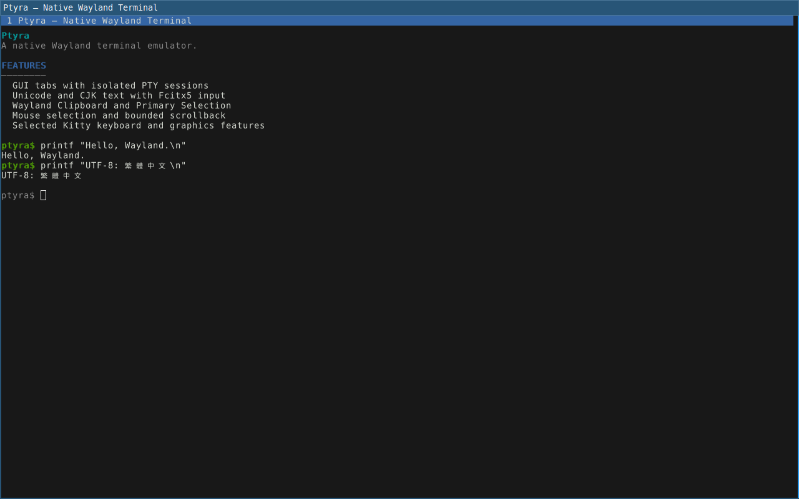

# Ptyra



Ptyra is a native Wayland terminal emulator written in Rust. It runs local shell sessions in one window with GUI tabs. Each tab owns its PTY, terminal state, scrollback, and text selection.

Ptyra focuses on low idle CPU use, bounded resource use, reliable copy and paste, and long-running sessions. It integrates with Wayland Clipboard, Primary Selection, and Fcitx5. It supports selected Kitty Keyboard and Kitty Graphics features, without claiming full protocol compatibility.

## Terminal and tabs

- Each tab has an independent shell process, PTY, terminal grid, scrollback, selection, and title.
- Hidden tabs continue processing PTY output. Ptyra renders only the active tab.
- The tab bar supports mouse clicks and configurable keyboard shortcuts. Closing the final tab closes the window.
- Mouse selection supports dragging, double-click word selection, and triple-click line selection. Hold Shift to select locally when an application has enabled terminal mouse reporting.
- Terminal output uses ANSI/VT behavior, including alternate screen, cursor styles, colors, and supported mouse and focus reporting.
- Unicode text includes CJK-width and combining-mark handling. Child shells receive `TERM=ptyra` and a private bundled terminfo entry.
- The application uses native Wayland surfaces and `wl_shm` rendering. Its UI does not use GTK, Qt, Electron, WebView, or XWayland.

## Build and run

Build with a Rust toolchain that supports the Rust 2024 edition:

```sh
cargo build --release --locked
./target/release/ptyra
```

The runtime requires Linux, a Wayland compositor with `xdg-shell` and `wl_shm`, a PTY, Fontconfig (`fc-match`), local fonts, and a shell. Chinese input requires compositor support with Fcitx5. Ptyra depends on native Linux, Wayland, font, and rendering libraries.

Use `SHELL` to select the shell executable. If it is unset, Ptyra uses `/bin/sh`. Hyperlinks open only after an explicit user action.

## Configuration

Pass a config file directly with `--config`:

```sh
./target/release/ptyra --config /absolute/path/to/config.toml
```

Without `--config`, Ptyra reads `$XDG_CONFIG_HOME/ptyra/config.toml` when `XDG_CONFIG_HOME` is absolute. Otherwise, it reads `$HOME/.config/ptyra/config.toml`. Missing files and omitted fields use defaults. Settings load at startup and do not live-reload.

Configuration files must be UTF-8 TOML and no larger than 64 KiB. Unknown fields, invalid types, out-of-range values, and duplicate shortcuts prevent startup. Errors report path, field, and reason metadata without printing config values or rewriting the file. See the [default configuration](assets/config.default.toml) and [example configuration](assets/config.example.toml).

| Setting | Default | Range or purpose |
|---|---:|---|
| `font_family` | `monospace` | Fontconfig family or pattern; up to 256 bytes, with no control characters |
| `font_size` | `14.0` | 1–256 logical pixels |
| `scrollback_lines` | `5000` | 0–10,000 lines per tab, subject to the shared cell budget |
| `clipboard_bytes` | `16777216` | 1–16 MiB; receive, paste, and saved-selection limit; oversized text is rejected |
| `osc52_write` | `false` | Enables PTY-originated Clipboard writes when explicitly set to `true`; reads stay denied |
| `glyph_cache_bytes` | `16777216` | 0–16 MiB shared glyph cache; `0` disables caching |
| `image_bytes` | `16777216` | 1–16 MiB limit for each transfer, decoded image, and per-tab image store |
| `image_pixels` | `4194304` | 1–4,194,304 pixels per image |
| `[colors]` | See defaults | `foreground`, `background`, and `cursor` as `#RRGGBB` values |
| `[colors.ansi]` | See defaults | Named overrides for the 16 ANSI colors |

Additional fixed limits include 64 tabs, 32,768 visible cells and 2,000,000 logical cells per tab, and 8,000,000 logical cells across all tabs. Conservative allocation budgets may reject a new tab or resize before those counts are reached.

Kitty Graphics uses a shared 128 MiB peak reserve. Each tab can retain up to 64 images and 256 placements. Font discovery is capped at 16 faces and 48 MiB of font data. The shared glyph cache is capped at 4,096 entries. These category limits do not guarantee a total process RSS limit.

## Keyboard shortcuts

| Action | Default shortcut |
|---|---|
| Copy / paste | `Ctrl+Shift+C` / `Ctrl+Shift+V` |
| New / close tab | `Ctrl+Shift+T` / `Ctrl+Shift+W` |
| Next / previous tab | `Ctrl+Page_Down` / `Ctrl+Page_Up` |
| Scroll one page up / down | `Shift+Page_Up` / `Shift+Page_Down` |
| Scroll to top / bottom | `Shift+Home` / `Shift+End` |
| IME key ownership | `Ctrl+Space` |

Shortcuts use `Ctrl`, `Shift`, `Alt`, or `Super` with an XKB keysym name. Each action must have a unique shortcut. `ime_toggle` reserves key ownership for the compositor and Fcitx5; it does not change the IME's configured hotkey.

## Clipboard and selection

Ptyra keeps the Wayland Clipboard separate from Primary Selection. Middle-click uses Primary Selection only when the compositor provides that capability; it never falls back to the ordinary Clipboard.

Copy preserves Unicode, spaces, tabs, and hard line breaks. Soft-wrapped lines do not gain extra newlines. Pressing Copy without a selection leaves the existing Clipboard owner unchanged.

During a drag, Ptyra keeps a bounded snapshot of the visible terminal content while the shell and PTY continue running. Releasing the mouse restores the live view and saves the selected text for later Copy. A new selection replaces that tab's saved text, and closing the tab releases it. Focus loss, tab changes, scrolling, resizing, and terminal-screen changes cancel an unfinished drag.

Saved selection text is limited by `clipboard_bytes`, and all tabs together may retain up to 16 MiB. Ptyra rejects oversized selections instead of silently truncating them. If Copy fails, the saved text remains available for another attempt.

A pending paste stays bound to the tab that requested it. Focus or tab changes and tab closure cancel the pending paste; Ptyra never redirects it to another shell. When the terminal enables bracketed paste, Ptyra sends the required framing. Otherwise, multiline paste asks for confirmation: Enter accepts and Esc cancels. Bracketed paste does not guarantee that every shell will prevent pasted commands from running.

OSC 52 Clipboard reads and writes are denied by default. Setting `osc52_write = true` allows bounded PTY-originated Clipboard writes with target checks; reads remain denied.

## Fcitx5 input

Ptyra uses Wayland `zwp_text_input_v3`. Sway and Fcitx5 communicate through `input-method-v2`, which the compositor handles. Ptyra does not depend on `GTK_IM_MODULE=fcitx` and does not change global IME environment settings.

Preedit text appears as a UI overlay and is never written to the PTY. Ptyra sends committed UTF-8 text once, after the matching `done` transaction, and only to the focused tab. Focus and tab checks prevent stale input from reaching another shell.
